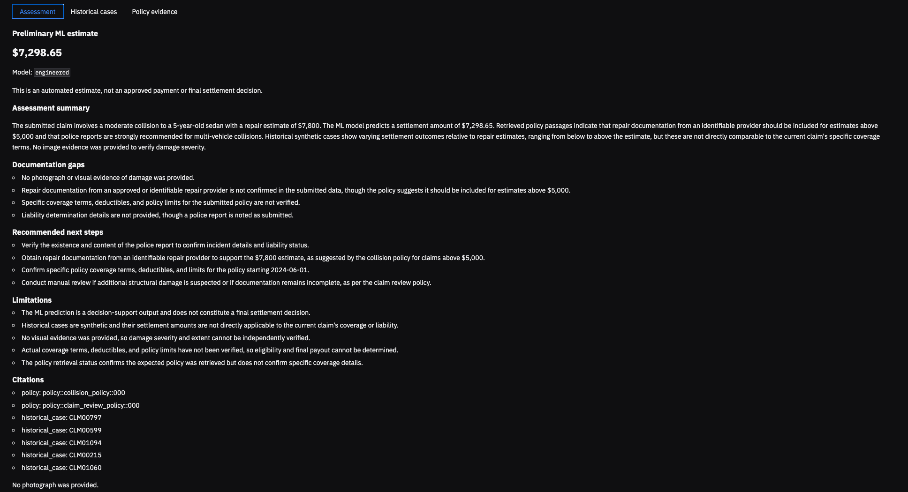

# Claim Intelligence Engine

A multimodal insurance-claim decision-support application that combines **XGBoost regression**, **dual-source retrieval-augmented generation (RAG)**, and **optional image captioning** to produce preliminary claim-amount estimates and evidence-grounded assessments.

The engine treats quantitative prediction and supporting evidence as separate responsibilities. XGBoost estimates a claim amount from structured attributes; ChromaDB retrieves similar synthetic historical cases and demonstration policy passages; an LLM produces a structured explanation with source references. Optional vehicle photographs are captioned locally using BLIP and supplied as unverified context, not as a substitute for damage assessment.

The pipeline is orchestrated explicitly in Python and exposed through a Gradio interface. It is **not an autonomous claim adjudication agent**.

> **Scope:** This is an educational project built with **synthetic claims and demonstration policy documents**. Estimates are not approved payments, historical settlements are not precedents, and generated assessments do not establish insurance coverage, liability, eligibility, or a final settlement.

---

## Demo



The Gradio application collects 14 structured claim inputs and an optional vehicle photograph. It presents the model estimate, generated assessment, supporting historical cases, and retrieved policy passages as distinct outputs.

**Additional application views:** [Claim form](screenshots/claim-form.png) · [Historical cases](screenshots/historical-cases.png) · [Policy evidence](screenshots/policy-evidence.png)

A representative, predefined collision claim produces an XGBoost estimate of **$7,298.65** using the saved engineered model. This is a demonstration input, not a real claim or authorized settlement; the generated explanation can vary by LLM/provider.

---

## System architecture

```text
                     Submitted claim + optional photograph
                                      |
                            Schema/input validation
                                      |
               +----------------------+----------------------+
               |                      |                      |
               v                      v                      v
       XGBoost regression       Dual-source RAG       Optional local BLIP
       Engineered features             |                Image caption
               |               +------+-------+              |
               |               |              |              |
               |               v              v              |
               |        Historical cases    Policies          |
               |          ChromaDB           ChromaDB          |
               |        840 train cases     3 chunks          |
               |               |              |              |
               +---------------+--------------+--------------+
                                      |
                     Structured, labeled evidence context
                                      |
                            Groq or Gemini LLM
                                      |
                       JSON and citation-ID validation
                                      |
                            Gradio results view
                  Estimate | Assessment | Evidence | Image
```

**Data preparation and indexing** are separate from request-time inference:

```text
Committed synthetic CSV (1,200 claims)
   |
   +--> Cleaning --> Processed CSV --> SQLite (all 1,200 claims)
   |                                    |
   |                                    +--> Training-only historical case records
   |                                              |
   +--> Fixed train / validation / test split      +--> Chroma: historical_claims
   |           |
   |           +--> Train/validate XGBoost
   |                   |
   |                   +--> Selected .joblib model
   |
   +--> Demonstration policy Markdown files --> Chroma: claim_policies
```

At inference time, `src.assessment.assess_claim()` coordinates prediction, retrieval, optional image processing, LLM generation, and response validation. This is a deterministic Python workflow rather than open-ended agent tool selection.

## Key capabilities

| Component | Implementation |
|---|---|
| Claim ingestion | Validation of numerical, categorical, and date fields; supported categories derived from training data |
| Structured prediction | Scikit-learn preprocessing pipeline with XGBoost regression and selected engineered features |
| Historical retrieval | Sentence Transformer embeddings, ChromaDB, incident/severity filters, and deterministic reranking |
| Policy retrieval | Independent ChromaDB collection containing traceable policy chunks |
| Multimodal input | Optional local BLIP caption of a vehicle photograph; no photograph required |
| Grounded synthesis | Configurable Groq/Gemini LLM, explicit evidence context, structured JSON response, citation-ID allowlist |
| Application | Gradio form and separate assessment, historical-case, and policy-evidence views |
| Reliability | Pytest coverage for validation, image handling, retrieval isolation, response structure, UI failures, and caching |

## Technology stack

| Layer | Technologies |
|---|---|
| Data preparation and analysis | Python, Pandas, NumPy, SQLite, Matplotlib |
| Structured ML | scikit-learn, XGBoost, Joblib |
| Retrieval | ChromaDB, Sentence Transformers (`all-MiniLM-L6-v2`) |
| Image processing | Pillow, PyTorch, Hugging Face Transformers (BLIP) |
| LLM generation | Groq or Google Gemini Python SDK |
| Application and testing | Gradio Blocks, pytest |

## Dataset and leakage controls

The project uses **1,200 synthetically generated vehicle insurance claims**, with **16 columns**: a claim identifier, 14 input attributes, and `claim_amount` as the regression target. The generator is available in [`data/generate_claims.py`](data/generate_claims.py); the committed input dataset is [`data/raw/claims.csv`](data/raw/claims.csv).

The submitted-claim schema covers:

- **Dates:** incident date and policy start date.
- **Numerical attributes:** driver age, vehicle age, annual mileage, vehicle value, repair estimate, and prior claims.
- **Categorical attributes:** incident type, vehicle type, weather, region, police-reported status, and reported damage severity.

The existing split is fixed and stratified by reported damage severity:

| Split | Records | Purpose |
|---|---:|---|
| Training | 840 (70%) | Model fitting and historical-case indexing |
| Validation | 180 (15%) | Baseline comparison and model selection |
| Test | 180 (15%) | Once-only held-out model evaluation |
| **Total** | **1,200** | |

**Leakage prevention:** Model features exclude `claim_id` and the target. The historical Chroma collection indexes **training records only**, verified against `data/splits/claim_splits.csv`. Historical `claim_amount` values are retained as case metadata for post-retrieval comparison, but are **not embedded in the searchable historical document text**. Validation and test claims are excluded from the historical-case index.

Data-quality checks retained all 1,200 records. The initial dataset report found no missing values or duplicate claim IDs and identified 71 statistical high-value outliers using the IQR rule; those records were not removed solely for being outliers. These findings describe the synthetic generator, not population-level insurance behavior.

**Data analysis:** [Full EDA report](reports/claims_data_quality_and_eda_report.md) · [Claim distribution](reports/figures/claim_distribution.png) · [Claim amount vs. repair estimate](reports/figures/repair_vs_claim.png) · [Claim amount by severity](reports/figures/average_claim_by_severity.png) · [Incident frequencies](reports/figures/Incident_frequency.png)

## Machine-learning pipeline

The regression pipeline uses imputation for numerical and categorical features, one-hot encoding for categoricals, and an `XGBRegressor`. The engineered candidate adds 10 derived features, including policy tenure, repair-to-value and mileage-to-age ratios, incident calendar attributes, prior-claim indicators, and driver/vehicle age bands.

Models were compared using **validation mean absolute error (MAE)**. The engineered model was selected by that predefined criterion; its improvement over the raw-feature model is small (about 0.24%), and the raw-feature model has a slightly better validation RMSE.

### Validation results

| Model | MAE (USD) | RMSE (USD) | R² |
|---|---:|---:|---:|
| Mean-prediction dummy baseline | 4,587.41 | 6,015.94 | ≈ 0.00 |
| Raw-feature XGBoost | 886.64 | **1,105.90** | 0.97 |
| **Engineered XGBoost (selected)** | **884.53** | 1,109.61 | 0.97 |

### Final held-out test results

The selected engineered model was evaluated on the 180 reserved test records **after model selection was complete**.

| Metric | Held-out test |
|---|---:|
| MAE | **$904.21** |
| RMSE | **$1,109.70** |
| R² | **0.9731** |
| Test records | **180** |

The recorded results are preserved in [`reports/final_model_evaluation.json`](reports/final_model_evaluation.json). The test set is **not** used to retune hyperparameters or reselect a model. These are results on a rule-generated synthetic target, so they are not evidence of accuracy on real insurer claims.

Model details and selection metadata: [`baseline_metrics.json`](models/baseline_metrics.json), [`engineered_metrics.json`](models/engineered_metrics.json), and [`model_selection.json`](models/model_selection.json).

## Dual-source retrieval

The system maintains two separate Chroma collections using `all-MiniLM-L6-v2` embeddings on CPU:

| Collection | Contents | Retrieval approach |
|---|---|---|
| `historical_claims` | 840 synthetic training cases | Query by claim attributes; filter by incident type and reported severity; rerank candidates |
| `claim_policies` | 3 chunks from 3 demonstration Markdown documents | Semantic similarity; retain source filename and chunk ID |

For historical comparisons, retrieval requests up to 25 candidate records, then prioritizes exact vehicle-type matches, smaller absolute differences in repair estimate, and vector distance, returning **up to five** cases. Searchable text excludes historical target amounts; retrieved metadata provides the historical amounts separately.

For policy evidence, retrieval returns **up to two** chunks with explicit source filenames and IDs. The available documents are:

- [`collision_policy.md`](knowledge/collision_policy.md)
- [`theft_policy.md`](knowledge/theft_policy.md)
- [`claim_review_policy.md`](knowledge/claim_review_policy.md)

There are **no dedicated demonstration policies for glass, hail, or vandalism**. A semantically retrieved passage is not automatically applicable to the claim, and Chroma distances are not calibrated relevance probabilities.

### Retrieval evaluation

| Synthetic scenario | Expected policy present in top 2 | Historical incident/severity filters | Vehicle-type match rate |
|---|---|---|---:|
| Collision documentation | Yes | Valid | 100% |
| Theft reporting | Yes | Valid | 40% |
| Severe claim review | Yes | Valid | 100% |

**Policy Hit@2 was 3/3 (100%)**, but this is a small targeted evaluation against three short policy documents, **not a production relevance benchmark**. The theft scenario also returned less comparable historical repairs (mean estimate difference $4,460.18), illustrating that retrieval quality varies across scenarios.

The full results are in [`reports/retrieval_evaluation.json`](reports/retrieval_evaluation.json).

## Optional image analysis

When a user supplies an image, the local pipeline uses `Salesforce/blip-image-captioning-base` to generate a short description. The application supports JPEG, PNG, and WebP, with size and dimension checks before inference. If no image is provided, BLIP is skipped.

The generated caption is labeled as **unverified machine-produced visual context**. It does **not** establish hidden structural damage, repair cost, or a confirmed severity classification, and it does not alter the XGBoost numerical prediction. An additional CLIP-based helper exists in `src/image_analysis.py` but is **not part of the default assessment path**.

The photograph itself is handled locally by BLIP; the resulting description may be included in the external LLM prompt. Initial model-weight downloads can be substantial and require network access.

## Grounded LLM assessment

`src/assessment.py` builds a structured prompt containing the validated submitted claim, ML prediction, retrieved cases, policy passages, policy-retrieval status, and optional image observations. The provider-specific API request is isolated in `src/llm_client.py` (Groq or Gemini).

The LLM is instructed to use provided evidence, preserve the strength of policy language (for example, *should* versus *must*), treat historical settlements as comparisons rather than entitlements, and avoid coverage or settlement determinations. The returned JSON contains:

```json
{
  "summary": "...",
  "documentation_gaps": [],
  "recommended_next_steps": [],
  "citations": [
    {
      "source_type": "policy",
      "source_id": "policy::collision_policy::000"
    }
  ],
  "limitations": []
}
```

*Illustrative response structure, not a transcript of a live assessment.*

Python validates required output fields, list/string types, citation-object structure, and each cited ID against the **actual retrieved evidence**. Malformed JSON, unsupported citation IDs, or provider errors cause an assessment failure rather than a fabricated fallback result. In Gradio, failed submissions clear previous result fields.

**Citation validity is not the same as factual faithfulness:** verifying that an ID was retrieved does not prove that the generated statement accurately interprets its text. Semantic grounding still requires assessment and human review.

### Grounding and robustness observations

The recorded manual review includes a collision claim without an image, a hail-policy knowledge-gap scenario, and an adversarial retrieved-text scenario. Those inspected runs were marked as passing for the report's citation-integrity, faithfulness, and decision-safety checks. A new image-enabled robustness run was **not completed** because downloading local model weights was interrupted; that scenario is explicitly marked **Not tested**, even though earlier integration runs exercised image handling.

See [`reports/assessment_robustness.md`](reports/assessment_robustness.md) for the scenario-by-scenario observations. These are small manual assessments, not comprehensive guarantees about all future LLM outputs.

## Local setup and execution

### 1. Requirements

- **Python 3.12** (version used in the development/test environment).
- Internet access for the initial package, embedding-model, and optional BLIP downloads.
- A **Groq or Gemini API key** for generated assessments.
- Sufficient disk space and memory for XGBoost, ChromaDB, Sentence Transformers, and optionally BLIP.

This project was developed on macOS. Other platforms may need platform-specific PyTorch installation adjustments. Always verify the active dependency constraints before setting up a new environment.

### 2. Clone and install

```bash
git clone https://github.com/Khalitus/applied-agentic-ai-projects.git
cd applied-agentic-ai-projects/05-claim-intelligence-engine

python3.12 -m venv .venv
source .venv/bin/activate

python -m pip install --upgrade pip
python -m pip install -r requirements.txt
python -m pip check
```

On Windows, activate the environment using the corresponding virtual-environment script rather than `source`.

### 3. Configure an LLM provider

```bash
cp .env.example .env.local
```

Edit `.env.local` and select **one** provider. For Groq, for example:

```dotenv
LLM_PROVIDER=groq
GROQ_API_KEY=your_api_key_here
GROQ_MODEL=openai/gpt-oss-20b
```

For Gemini, set `LLM_PROVIDER=gemini`, provide `GEMINI_API_KEY`, and set `GEMINI_MODEL` to a model accessible to your account. Provider model availability and usage limits may change; use a currently supported identifier.

The `.env.local` file is Git-ignored. **Never commit keys or real claim details.** Although the Gradio app runs on localhost and ML/retrieval/image captioning are local, the structured assessment prompt is sent to the selected external LLM provider.

### 4. Rebuild local artifacts

The repository includes the **raw CSV, saved split assignments, policy Markdown, and evaluation reports**. It intentionally does **not** commit processed CSVs, the SQLite database, trained `.joblib` files, or the Chroma vector store.

From the project root, run these commands in order:

```bash
# Clean the committed synthetic dataset
python -m src.clean_data

# Build the SQLite claims table
python -m src.build_database

# Fit baseline and engineered model pipelines
python -m src.train_baseline
python -m src.train

# Index training cases and synthetic policy documents
python -m src.build_vector_store
python -m src.inspect_vector_store
```

This produces the processed dataset, SQLite database, trained model artifacts, and two persistent Chroma collections. The expected Chroma counts are **840 historical cases** and **3 policy chunks**. The embedding-model download may make the initial vector-store build slower.

**Reproducibility note:** The saved `claim_splits.csv` should be kept unchanged. Retraining creates a new local model artifact and may rewrite the selection manifest (including its `test_evaluated` flag); the committed held-out report describes the previously evaluated frozen model and must not be treated as a new test evaluation of a retrained model. Do not rerun the final held-out test to tune the model.

### 5. Launch the application

```bash
python -m src.app
```

Open **http://127.0.0.1:7860**. The app is configured for local use (`share=False`) and accepts an optional image upload. Submit the demonstration claim, then inspect the **Assessment**, **Historical cases**, and **Policy evidence** tabs.

### 6. Other entry points

```bash
# Prediction without LLM or image inference
python -m src.predict

# Retrieval evaluation (uses the local Chroma store)
python -m src.evaluate_retrieval

# Grounded LLM assessment for the predefined demo claim
python -m src.assessment

# Optional captioning path; requires local BLIP model weights
python -m src.assessment --image path/to/vehicle_image.jpg

# Inspect the local vector collections
python -m src.inspect_vector_store
```

The final held-out evaluation report is already committed. `src.evaluate_final_model` intentionally refuses to overwrite an existing report; it is **not** part of routine app setup.

## Testing and performance

Run the project's automated suite from the project root:

```bash
python -m pytest tests/ -v
```

The tests cover feature engineering, input validation, prediction determinism, image handling, case/policy indexing, retrieval filtering and attribution, LLM response validation, application error behavior, robustness scenarios, and model/collection caching. Most integration tests use mocks to avoid unnecessary external API calls or model downloads.

Performance was measured locally with three prediction calls and three retrieval calls per benchmark run. Reported *warm* medians use only the final two invocations; they are indicative measurements, not statistically robust latency guarantees.

| Operation | Before: warm median | After: warm median |
|---|---:|---:|
| XGBoost prediction | 56.2 ms | **49.4 ms** |
| Combined historical + policy retrieval | 133.9 ms | **117.0 ms** |

First-call timings were not improved consistently: prediction measured 1.49 s before versus 7.10 s after, and retrieval 52.48 s versus 53.84 s. Much of the retrieval startup cost arises during resource initialization, but the benchmark does not isolate every contributing stage. The *before* and *after* reference outputs—including the numerical prediction and retrieved IDs—matched exactly.

Reports: [`performance_before.json`](reports/performance_before.json) · [`performance_after.json`](reports/performance_after.json).

## Project structure

```text
05-claim-intelligence-engine/
├── data/
│   ├── generate_claims.py                # Synthetic data generator
│   ├── raw/claims.csv                    # Committed synthetic claims
│   └── splits/claim_splits.csv           # Fixed train/validation/test IDs
├── knowledge/                            # Three synthetic policy documents
├── models/
│   ├── baseline_metrics.json
│   ├── engineered_metrics.json
│   └── model_selection.json             # Selected model metadata
├── reports/
│   ├── figures/                         # Four EDA figures
│   ├── claims_data_quality_and_eda_report.md
│   ├── retrieval_evaluation.json
│   ├── final_model_evaluation.json
│   ├── assessment_robustness.md
│   ├── performance_before.json
│   └── performance_after.json
├── screenshots/
│   ├── claim-form.png
│   ├── assessment.png
│   ├── historical-cases.png
│   └── policy-evidence.png
├── src/
│   ├── app.py                            # Gradio interface
│   ├── assessment.py                     # End-to-end grounded assessment
│   ├── llm_client.py                     # Groq / Gemini adapters
│   ├── predict.py                        # Input validation and inference
│   ├── features.py                       # Engineered model features
│   ├── train_baseline.py                 # Dummy and raw-feature baselines
│   ├── train.py                          # Engineered training and selection
│   ├── retrieval.py                      # Dual retrieval and reranking
│   ├── knowledge_documents.py           # Historical/policy record preparation
│   ├── build_vector_store.py            # Chroma indexing
│   ├── image_analysis.py                # Optional BLIP captioning
│   ├── build_database.py                # SQLite construction
│   ├── evaluate_retrieval.py            # Retrieval scenarios
│   ├── evaluate_final_model.py          # Guarded held-out evaluation
│   ├── benchmark.py                     # Local timing harness
│   └── ...                              # Data cleaning, EDA, SQL and inspections
├── tests/                                # Nine pytest modules
├── .env.example                          # Placeholder provider configuration
├── .gitignore
├── requirements.txt
└── README.md
```

Generated `.joblib`, processed CSV, SQLite, and Chroma artifacts are recreated locally and ignored by Git.

## Limitations and potential improvements

This project deliberately prioritizes traceability and a small reproducible architecture over simulated production readiness.

- **Synthetic evaluation only.** The target was generated from known feature relationships; the model has not been validated on real insurance data, changing portfolios, or operational settlement outcomes.
- **Incomplete policy corpus.** Only collision, theft, and general review documents are represented. Retrieval can return a semantically similar but inapplicable passage, and the three-scenario retrieval test is small.
- **No contractual decisions.** The policies are demonstration material. The engine cannot verify actual coverage, liability, exclusions, deductibles, or binding claim obligations.
- **Limited grounding verification.** Citation IDs are checked programmatically, but correct interpretation of every statement is not guaranteed. Manual LLM checks cover a limited set of scenarios, and image-enabled robustness retesting remains incomplete.
- **Visual uncertainty.** BLIP captions can be generic or incorrect; they are not validated damage detection, repair assessment, or severity classification.
- **Cold-start cost.** Loading the embedding stack and Chroma collection handles is relatively expensive on the measured local setup. Caching helps subsequent requests but does not eliminate startup time.
- **Operational scope.** This is a single-user local demonstration without deployment-grade authentication, audit logging, monitoring, privacy governance, or contract/policy version management. External LLM calls depend on provider availability and limits.

Potential future work includes a larger labeled retrieval benchmark, claim-to-policy applicability checks, statement-level citation verification, out-of-distribution detection, stronger image evaluation, and a reproducible deployment environment with privacy and access controls.

---

**Repository:** [Applied Agentic AI Projects — Claim Intelligence Engine](https://github.com/Khalitus/applied-agentic-ai-projects/tree/main/05-claim-intelligence-engine)

**Purpose:** Demonstrate the integration of structured regression, evidence retrieval, optional local vision-language inference, validated LLM output, and an inspectable user interface—without conflating predictive estimates with claim decisions.
