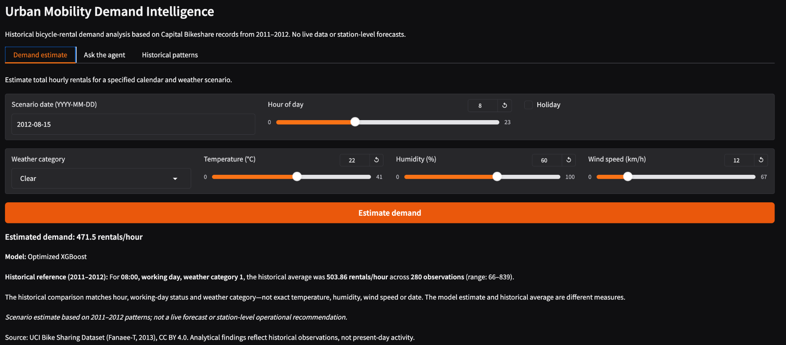

# Urban Mobility Demand Intelligence

Historical bicycle-rental demand analysis with **XGBoost hourly scenario estimation**, **SQLite evidence retrieval**, and a **bounded tool-calling AI agent** accessible through Gradio.

The application estimates total hourly rentals for a specified calendar and weather scenario, places the estimate alongside comparable historical observations, and answers natural-language questions using a fixed set of validated analytics tools. It uses **2011–2012 Capital Bikeshare data** and is **not a live or operational demand forecasting service**.

## Application

The Gradio interface provides three independent workflows:

| View | Purpose |
|---|---|
| **Demand estimate** | Enter a date, hour, holiday flag, weather category, temperature, humidity, and wind speed; receive an optimized XGBoost estimate and a scoped historical comparison. |
| **Ask the agent** | Ask questions about hourly patterns, working days, and weather. A Groq/Gemini agent chooses approved tools and summarizes returned evidence. |
| **Historical patterns** | Plot mean hourly rental demand separately for working and non-working days using SQL aggregates. |



*Example: the optimized model estimated 471.5 rentals/hour for an August 15, 2012, 08:00 scenario. The historical reference was 503.86 rentals/hour across 280 observations matched by hour, working-day status, and weather category. These are different measures.*

## System architecture

```text
Official UCI Bike Sharing Dataset (hour.csv)
        |
        +--> Validation and feature engineering --> Chronological XGBoost training
        |                                             |
        |                                       Optimized model
        |                                             |
        +--> SQLite ingestion --> Restricted analytics tools
                                  |                  |
                                  +--> Tool registry / argument validation
                                             |
User question --> Groq or Gemini --> Tool calls --> Structured tool results
                                             |
                                    Grounded agent response

User scenario --> Validated prediction --> Historical SQL comparison
                                                    |
                                         Gradio application
```

**Component boundaries:** `src/data.py` validates the source; `src/db.py` manages SQLite ingestion; `src/analytics.py` provides fixed aggregation queries; `src/features.py` unifies training and scenario inputs; `src/train.py` and `src/optimize.py` fit and evaluate the models; `src/predict.py` performs inference; `src/agent_tools.py` validates tool execution; `src/agent.py` orchestrates providers; and `app.py` renders the interface.

Detailed architecture: [docs/architecture.md](docs/architecture.md).

## Dataset and feature contract

- **Source:** Fanaee-T, H. (2013), *Bike Sharing*, UCI Machine Learning Repository ([DOI](https://doi.org/10.24432/C5W894), CC BY 4.0).
- **Coverage:** 17,379 hourly records spanning January 2011 through December 2012, across 731 calendar dates.
- **Target:** `cnt`, total recorded rentals within one hour.
- **Model inputs (10):** `mnth`, `hr`, `holiday`, `weekday`, `workingday`, `weathersit`, `temp`, `hum`, `windspeed`, `commute_peak`.
- **Leakage prevention:** `casual`, `registered`, and `cnt` are excluded from model inputs; `casual + registered = cnt` is validated during ingestion.

`commute_peak` is derived from working-day status and selected peak hours. It showed high tree importance, but a validation ablation did **not** demonstrate incremental improvement, so its usefulness should not be overstated. The ten-feature application contract was retained for consistency.

The raw CSV and generated data are not committed to the repository. Download instructions are below.

## Reproduce locally

**Prerequisites:** Python 3.12, internet access for the initial dataset download, and a Groq or Gemini API key only if you want natural-language agent responses. The model and SQL functions operate locally without an LLM key.

From `06-urban-mobility-intelligence`:

```bash
python3.12 -m venv .venv
source .venv/bin/activate
python -m pip install -r requirements.txt

python -m scripts.download_data
python -m src.db
python -m src.train
python -m src.optimize
```

Set up the agent environment (never commit `.env`):

```bash
cp .env.example .env
```

```dotenv
AGENT_PRIMARY_PROVIDER=groq
GROQ_API_KEY=your_key
GROQ_MODEL=openai/gpt-oss-120b
GEMINI_API_KEY=
GEMINI_MODEL=gemini-3.5-flash-lite
```

At least one provider key is required for the agent tab. Model availability and account quotas are managed by the respective provider and may change.

Verify the local artifacts and start the application:

```bash
python -m pytest -q
python -m scripts.release_check
python app.py
```

Open the local Gradio address, normally `http://127.0.0.1:7860`. Existing activated environments can be used without creating another virtual environment.

## Machine learning evaluation

Training and model selection use complete chronological date boundaries. The outer split contains 13,891 training records through **August 6, 2012**, and 3,488 subsequent holdout records from **August 7, 2012**. Hyperparameters were selected using an earlier validation interval within the outer training period.

| Method | Holdout MAE ↓ | Holdout RMSE ↓ | Holdout R² ↑ |
|---|---:|---:|---:|
| Global training mean | 174.971 | 232.559 | — |
| Hour-of-day training mean | 113.678 | 167.319 | — |
| Initial XGBoost | 89.589 | 126.341 | 0.6717 |
| **Selected XGBoost** | **88.445** | **124.719** | **0.6801** |

The selected configuration (`deeper_regularized`) reduced holdout MAE by approximately **1.28%** relative to the initial XGBoost model and by **22.20%** relative to the hour-of-day benchmark. These are historical holdout results, not future deployment accuracy claims.

The holdout had already been inspected during baseline development; it is **not a wholly untouched final test set**. Further optimization on the same observations would risk biased reporting. See [model evaluation](docs/model_baseline.md) and [optimization details](docs/model_optimization.md).

## Agent execution and grounding

The agent exposes exactly six approved operations:

| Tool | Output |
|---|---|
| `hourly_profile` | Demand statistics at a specified hour |
| `compare_workdays` | Historical working-/non-working-day comparison |
| `weather_impact` | Demand statistics by recorded weather category |
| `hourly_demand` | Hour-by-hour averages, optionally filtered by working-day status |
| `historical_reference` | Aggregates matching specified categorical conditions |
| `estimate_scenario` | Optimized XGBoost estimate and comparable historical SQL evidence |

The model **cannot execute arbitrary SQL, file operations, or Python code**. Each function request passes through a registry, argument schema validation, and a bounded dispatcher. Tool calls are limited to four rounds and eight invocations per provider attempt. Only provider/API failures trigger a fresh attempt with the configured alternate provider; previously returned tool text does not grant authority to execute new operations.

Python calculates working-day comparison values, including the verified **11.80 rentals/hour** and **6.50%** relative difference, instead of delegating arithmetic to the LLM. Generated prose can still contain mistakes, so verify significant numerical claims against the returned data.

**Conversation scope:** Each message is processed independently. Prior messages remain visible in the Gradio chat but are not supplied to the model as follow-up context. Repeat relevant conditions in a new question.

See [tool contract](docs/agent_tool_contract.md), [execution behavior](docs/agent_execution.md), and [provider routing](docs/provider_fallback.md).

## Validation and generated artifacts

Automated checks cover feature consistency, temporal splitting, model persistence, SQL restrictions, argument validation, provider fallback, tool-call bounds, Gradio outputs, and offline release diagnostics. Tests simulate provider responses and do not require live API access.

```bash
python -m pytest -q                        # Deterministic regression suite
python -m scripts.release_check            # Data, SQLite, model, inference, tool contract
python -m scripts.agent_smoke_test         # Live provider smoke test (uses quota)
python -m scripts.evaluate_agent --live     # Optional four-case live evaluation (uses quota)
```

The last command writes `reports/agent_evaluation.json`, with a **heuristic numeric-evidence check**, not a certification of correctness. Inspect answers manually for units, sample sizes, context and unsupported claims. The `reports/`, `models/`, and downloaded data directories remain Git-ignored. Only deserialize trusted, locally generated model artifacts.

Read the [release validation guide](docs/release_validation.md) for test coverage and browser acceptance checks.

## Repository overview

```text
06-urban-mobility-intelligence/
├── app.py
├── src/
│   ├── agent.py               # Gemini/Groq orchestration
│   ├── agent_tools.py         # Six schemas and safe dispatch
│   ├── analytics.py           # Restricted SQLite aggregations
│   ├── config.py
│   ├── data.py
│   ├── db.py
│   ├── features.py
│   ├── optimize.py
│   ├── predict.py
│   └── train.py
├── scripts/                  # Data download, smoke tests, release checks
├── tests/                    # Deterministic automated regression suite
├── docs/                     # Architecture, evaluation and operations
├── screenshots/              # Captured application interface
├── data/                     # Downloaded and processed data (ignored)
├── models/                   # Serialized trained models (ignored)
└── reports/                  # Generated evaluations (ignored)
```

## Limitations and intended use

- The dataset covers **2011–2012**; there is no real-time weather, bicycle inventory, current system activity, or station-level information.
- The model does not explicitly encode year-on-year network growth. Date inputs chiefly provide calendar features, not a reliable forecast for a future year.
- SQL comparisons match categorical conditions, **not** exact temperature, humidity, wind speed, or date.
- Weather category 4 contains only **three observations**, making category-specific conclusions unreliable.
- One internal validation window and a previously inspected holdout are insufficient evidence for operational deployment.
- Agent responses may have arithmetic, wording, or grounding errors even when the backend retrieves correct values. An API key and an available provider are required for the conversational component.

**Purpose:** A reproducible applied-AI engineering project demonstrating data integrity, SQL analytics, supervised regression, controlled model selection, tool-calling orchestration, and a working interactive interface—not a production transportation decision system.

## Attribution and licensing

Dataset: Fanaee-T, H. (2013), *Bike Sharing*, UCI Machine Learning Repository, [DOI: 10.24432/C5W894](https://doi.org/10.24432/C5W894), distributed under **CC BY 4.0**. Licensing for project source code follows the parent repository's license, if one is provided.
